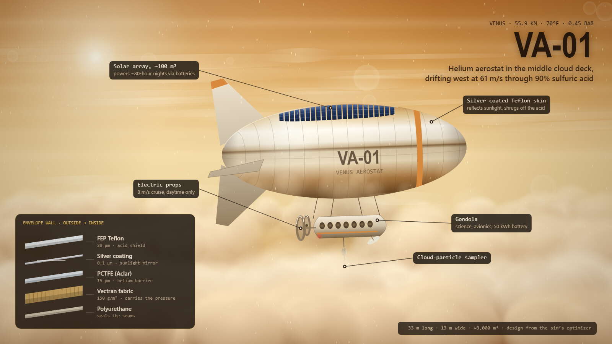

# Venus Cloud Blimp

A browser simulation of a helium blimp in the sulfuric acid clouds of Venus, plus a design lab that uses a machine-learning optimizer to search for the best envelope materials and hull shape.

Open `venus-blimp.html` in any modern browser. There is no build step and nothing to install.

## Flight view

Fly the blimp at the altitude where the outside air is 70°F (about 55.9 km, 0.45 bar).

- **Atmosphere:** an approximate Venus International Reference Atmosphere (VIRA) temperature profile down to the 465°C, 92 bar surface. Pressure is integrated hydrostatically. Thermal tides, gravity waves and convective updrafts perturb it.
- **Acid clouds:** droplet density follows the published total cloud mass (about 0.22 kg/m²), densest in the lower cloud near 48–50 km. Acid strength rises from about 80% at the cloud tops to 99% at the cloud base.
- **Envelope physics:** a sealed superpressure envelope with helium leakage, sunlight heating the gas, acid erosion of each layer, fabric aging, burst, and going slack. A blimp that loses its helium sinks to the surface, and each material fails as it passes its temperature limit.
- **Altitude trim:** a 2.5 kW compressor packs outside CO₂ into a tank at about 16 kg/h, and venting trims upward.
- **Winds:** the blimp drifts with the super-rotation (about 61 m/s westward), circling Venus in about 7 Earth days. The Sun rises in the west.

## Design lab

A cross-entropy-method optimizer, a simple machine-learning search, evolves envelope designs:

- **Genes:** outer acid-shield film, mirror coating, helium-barrier film, strength fabric, the three layer thicknesses, the hull's length-to-width ratio, and helium overfill.
- **Fitness:** each candidate is sized to float at the target temperature and flown through a full mission in 6-hour steps. It is scored on days spent within ±5°F of the target, its total mass, and a minimum safety factor.
- **Learning:** each generation, the top 20% pull the sampling distributions toward themselves. The page shows the learning curve, the latest population, the learned odds for each material, and the best design's mission timeline.
- **Caution setting:** materials without real sulfuric acid test data can be assumed to erode 10× faster than estimated, which shows how much the answer depends on unverified numbers.

Mission settings: target temperature, payload, cruise airspeed, mission length, mass penalty, minimum safety factor.

## Caveats

Material properties come from chemical-resistance ratings and published values. Acid erosion rates, helium permeabilities and aging rates are order-of-magnitude estimates, not measured Venus data, and the optimizer can only be as right as those numbers. The blimp is drawn about 10× its real size in the flight view. This is a simulation for intuition, not mission design.

## License

[MIT](LICENSE)
